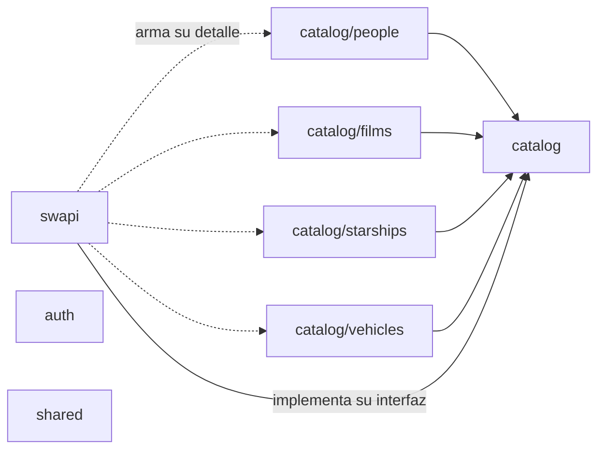
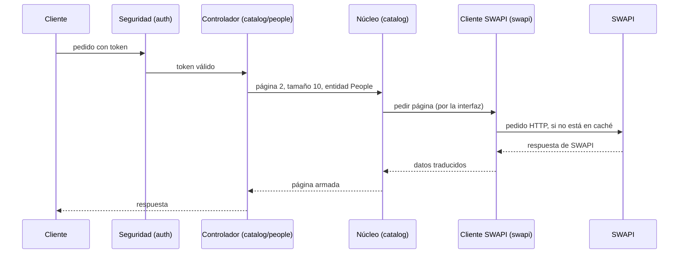

# Arquitectura

Cómo se organiza el código y qué reglas sigue. Es la referencia para el día a día: dónde va cada cosa y qué puede depender de qué. El porqué de cada decisión está en los [ADRs](adr/README.md).

> **Estado:** describe la estructura del MVP, que ya está construida. El código nuevo se escribe siguiendo este documento; si la estructura cambia, primero se registra un ADR y después se actualiza acá.

## En una frase

Una API en Spring Boot que lee los datos de Star Wars desde SWAPI, los pagina y los filtra de forma uniforme, y los protege con login. No guarda datos de Star Wars: su base de datos contiene solo usuarios.

## Carpetas

El código se organiza por funcionalidad ([ADR-0002](adr/0002-code-organization.md)).

```
src/main/java/io/github/erickvaernet/starwars
├── auth/          login, emisión del token, reglas de acceso y alta de usuarios
├── catalog/       núcleo común: páginas, filtros, detalle y la interfaz hacia la fuente de datos
│   ├── people/    controlador y datos de detalle de People
│   ├── films/
│   ├── starships/
│   └── vehicles/
├── swapi/         cliente de SWAPI, traducción de sus respuestas y caché
└── shared/        errores, configuración y documentación de la API

src/main/resources/db
├── migration/     tablas e índices
└── seed/          usuarios de prueba

src/test/java/...  misma estructura de carpetas que el código que prueba
```

| Carpeta     | Qué contiene                                                                                   | Qué no contiene                                    |
|-------------|------------------------------------------------------------------------------------------------|----------------------------------------------------|
| `auth`      | El pedido de login, la emisión del token, la tabla de usuarios, las reglas de acceso (también la que reserva un pedido a un rol) y el alta de usuarios | Nada sobre Star Wars |
| `catalog`   | El modelo de página, los filtros, la validación del identificador, la lógica de paginación y la interfaz de la fuente de datos | Nada con el formato de SWAPI |
| `catalog/*` | Por entidad: su controlador, su documentación, sus datos de detalle, con los nombres de esta API, y el nombre que la documentación le da a un elemento de su listado | Lógica de paginación o de filtros, ni nombres de campos de SWAPI (salvo el campo de búsqueda que la entidad declara para la fuente) |
| `swapi`     | Los pedidos HTTP a SWAPI, la traducción de sus respuestas (por entidad, la de su detalle) y la caché | Controladores o reglas de la API propia   |
| `shared`    | El formato de los errores, la configuración general y la de la documentación de la API         | Lógica de una funcionalidad en particular          |

## Reglas de dependencia



1. **`catalog` no conoce a `swapi`.** `catalog` define la interfaz de la fuente de datos y `swapi` la implementa.
2. **El formato de SWAPI no sale de `swapi`.** Sus respuestas se traducen ahí al modelo de `catalog`. Para eso `swapi` conoce los datos de detalle de cada entidad, que están en `catalog/*`; al revés no: ninguna carpeta de `catalog` conoce a `swapi`, ni los nombres de sus campos, ni sus direcciones. Lo único de SWAPI que una entidad declara en `catalog` son dos textos que el núcleo no interpreta y le pasa a la fuente tal cual: su nombre en SWAPI y su campo de búsqueda.
3. **`auth` y `catalog` no dependen entre sí.**
4. **Nada depende de un controlador.**
5. **Cualquier carpeta puede usar `shared`;** `shared` no usa a ninguna otra.

Estas reglas se comprueban con tests de arquitectura ([ADR-0009](adr/0009-testing-strategy.md)). Si una se rompe, los tests fallan.

## Recorrido de un pedido

Ejemplo: `GET /api/v1/people?page=2&size=10`.



1. La seguridad valida el token. Sin token válido, responde 401 y el pedido no sigue ([ADR-0005](adr/0005-authentication.md)). Si el pedido está reservado a un rol y el del token no alcanza, responde 403 y tampoco sigue ([ADR-0017](adr/0017-role-based-access.md)).
2. El controlador de la entidad valida los parámetros y llama al núcleo.
3. El núcleo pide los datos por la interfaz, sin saber que detrás está SWAPI.
4. El cliente de SWAPI responde desde la caché o hace el pedido HTTP ([ADR-0003](adr/0003-swapi-client.md), [ADR-0011](adr/0011-swapi-response-cache.md)). Si el pedido falla de una forma que suele ser pasajera, lo repite una vez antes de darlo por fallido ([ADR-0020](adr/0020-swapi-failure-tolerance.md)).
5. El núcleo arma la página: usa la de SWAPI si vino paginada, o recorta en memoria si vino la lista completa ([ADR-0004](adr/0004-pagination-and-filters.md)).

Con un filtro el recorrido es el mismo; lo que cambia es qué le pide el núcleo a la fuente. Con un identificador no pide una página: pide ese elemento.

| Pedido                              | Qué le pide el núcleo a la fuente              | Qué responde                                                                  |
|-------------------------------------|------------------------------------------------|-------------------------------------------------------------------------------|
| `GET /api/v1/people?id=1`           | El elemento 1 de People                        | Una página con el resumen de ese elemento, o vacía si no existe               |
| `GET /api/v1/people/1`              | El elemento 1 de People                        | Todos sus datos, o `404` si no existe                                         |
| `GET /api/v1/people?name=sky`       | Los elementos de People cuyo nombre contiene "sky" | La página pedida de las coincidencias, o vacía si no hay ninguna          |
| `GET /api/v1/people?id=1&name=luke` | El elemento 1 de People                        | Una página con ese elemento si su nombre contiene "luke"; si no, vacía        |

- El identificador y el texto de búsqueda se validan en `catalog`, cada uno en un solo lugar, antes de pedirle nada a la fuente. El identificador vale igual para el parámetro y para la ruta.
- Los dos pedidos por identificador son el mismo para la fuente, así que comparten la respuesta guardada en la caché. El de identificador y nombre también: el nombre se comprueba en `catalog`, sobre el elemento que devolvió la fuente, y no se hace ninguna búsqueda.
- Que un elemento no exista es una respuesta normal de la fuente, no una falla, y no se guarda.
- El texto de búsqueda se guarda sin los espacios de los extremos y en minúsculas. Así dos búsquedas que solo difieren en eso son el mismo pedido a la fuente y la misma respuesta guardada.
- La fuente responde una búsqueda igual que un listado: con una página y su total, o con todo junto. Hoy SWAPI devuelve todas las coincidencias juntas, y el núcleo recorta la página. La caché guarda esa respuesta completa sin página ni tamaño, así que recorrer las páginas de una búsqueda es un solo pedido a SWAPI.

### Con los datos completos de cada elemento

Ejemplo: `GET /api/v1/people?expanded=true&size=2`. El recorrido es el del diagrama; cambia qué se pide y qué vuelve en cada paso ([ADR-0019](adr/0019-expanded-listings.md)).

1. El controlador valida los parámetros, entre ellos `expanded`, que solo acepta `true` o `false`, y llama al núcleo con la misma línea que sin él.
2. El núcleo le pide a la fuente la misma página, **con los elementos completos**. Es otro pedido de la interfaz, distinto del de la página de resúmenes.
3. El cliente de SWAPI hace **un solo pedido HTTP**, el del listado con `expanded=true`, y lee cada elemento con la traducción del detalle de su entidad: la misma que usa cuando se pide un elemento solo.
4. La caché guarda esa respuesta aparte de la de resúmenes, y guarda además cada elemento por su identificador.
5. El núcleo arma la página con el mismo código que para los resúmenes, sin mirar qué trae cada elemento.

| Pedido                                         | Qué le pide el núcleo a la fuente                         | Qué responde                                                          |
|------------------------------------------------|-----------------------------------------------------------|-----------------------------------------------------------------------|
| `GET /api/v1/people?expanded=true`             | La página de People, con los elementos completos          | La página, con el detalle de cada personaje                           |
| `GET /api/v1/people?name=sky&expanded=true`    | Los elementos completos de People cuyo nombre contiene "sky" | La página pedida de las coincidencias, cada una con su detalle     |
| `GET /api/v1/people?id=1&expanded=true`        | El elemento 1 de People, como siempre                     | Una página con ese elemento en vez de su resumen, o vacía si no existe |
| `GET /api/v1/people?expanded=false`            | La página de resúmenes: es el pedido de siempre           | La página, con `id` y `name` en cada elemento                         |

- **El núcleo sigue sin conocer los datos de ninguna entidad.** De un elemento completo solo sabe pedirle su resumen, que usa para comparar el nombre cuando hay `id` y `name` juntos.
- **Las dos formas de respuesta de la fuente valen igual:** la página con su total, o todo junto. SWAPI ignora `expanded` en Films y en las búsquedas, que ya traían todos los datos; se le envía igual y se decide por lo que llega.
- **Un elemento que no se puede traducir hace fallar toda la página,** con `502`: por ejemplo, una relación cuya dirección no termina en un identificador. El listado de resúmenes no lee esos datos.
- **Después de un listado completo, el detalle de cualquiera de sus elementos no vuelve a SWAPI,** y el filtro por su ID tampoco: son el mismo pedido a la fuente y ya está guardado.
- **Pedir el mismo listado de las dos formas son dos pedidos a SWAPI.** Las respuestas no se comparten: armar los resúmenes a partir de los datos completos haría que el listado común dependiera de traducir todos los datos de cada elemento.
- **En la documentación de la API, un elemento de un listado es "uno de dos":** el resumen o el detalle de la entidad. Java no tiene un tipo para eso, así que cada entidad declara una interfaz que nada implementa, solo para que la documentación lo lea del tipo de la respuesta (ejemplo: `catalog/people/PersonListElement`). El costo y las alternativas están en el ADR-0019.

## Cómo se agrega una entidad

Sumar una entidad de SWAPI (por ejemplo, Planets) no toca la paginación, los filtros, la validación, la caché ni los errores:

1. Grabar sus respuestas reales de SWAPI y escribir sus tests de aceptación, antes que el código ([flujo de trabajo](process/WORKFLOW.md)). Son dos cosas: una clase con los criterios propios de la entidad (ejemplo: `catalog/films/FilmsAcceptanceTest`), y su ruta en las listas de los criterios que comparten las cuatro entidades, que están en `catalog/PaginationAcceptanceTest`, en `auth/ProtectedAccessAcceptanceTest` y en `ApiDocumentationAcceptanceTest`. Este último comprueba que la documentación de la API tiene exactamente los pedidos previstos: se le suman los dos de la entidad. Y sus pedidos se suman a la [colección de pedidos](api/star-wars-api.postman_collection.json): `RequestCollectionAcceptanceTest` la compara con la documentación de la API y falla hasta que estén.
2. Crear su carpeta dentro de `catalog`.
3. Definir ahí sus datos de detalle, con los nombres de esta API, y decir cuál de ellos es su nombre en un listado (en Films, el título). Ejemplos: `catalog/people/PersonDetail` y `catalog/films/FilmDetail`. Y, al lado, el nombre que la documentación le da a un elemento de su listado, que es "su resumen o su detalle": una interfaz vacía con una anotación. Ejemplos: `catalog/people/PersonListElement` y `catalog/films/FilmListElement`. Y los dos ejemplos que la documentación muestra para la respuesta de su listado, la misma página con los resúmenes y con los datos completos: tienen que ser respuestas reales, y un test de aceptación los compara con lo que responde la API. Ejemplo: `catalog/people/PeopleListExamples`.
4. Declarar en su controlador su ruta y sus dos pedidos: el listado y el detalle. Cada uno es una línea que llama al núcleo; el listado devuelve una página de ese nombre del paso 3, y con eso acepta `expanded` sin nada más. Ahí mismo se declaran, en un `CatalogEntity`, los dos datos que la fuente necesita de la entidad: su nombre en SWAPI y el campo de SWAPI que tiene el nombre de cada elemento, que es también el campo por el que se busca (`name`; en Films, `title`). Ejemplos: `catalog/people/PeopleController` y `catalog/films/FilmsController`. En la documentación de la API los dos pedidos quedan con candado sin declarar nada: el token se exige por defecto ([ADR-0008](adr/0008-api-documentation.md)).
5. Escribir en `swapi` su traducción: los datos de la entidad con los nombres de SWAPI y cómo pasan a su detalle. Ejemplos: `swapi/SwapiPerson` y `swapi/SwapiFilm`. Y sumar una línea a la tabla de formatos de `swapi/SwapiCatalogSource`, que dice con qué traducción se lee cada entidad: vale para un elemento pedido solo y para cada elemento de un listado con datos completos.

Cada pieza de los pasos 3 a 5 lleva su test unitario, escrito antes que ella.

El paso 5 es el único del código que queda fuera de la carpeta de la entidad. Está ahí porque los nombres de los campos de SWAPI no pueden aparecer en `catalog` ([ADR-0002](adr/0002-code-organization.md), nota del 15/11/2026).

Films fue la primera entidad que se sumó con estos pasos (ticket #12), y no hizo falta nada fuera de ellos.

## Decisiones transversales

| Tema                       | Regla                                                                                   | ADR                                            |
|----------------------------|-----------------------------------------------------------------------------------------|------------------------------------------------|
| Plataforma                 | Spring Boot 4.1 sobre Java 21, compilado con nivel de lenguaje 21                       | [ADR-0001](adr/0001-platform-and-build.md)     |
| Rutas                      | Todas bajo `/api/v1`                                                                    | [ADR-0004](adr/0004-pagination-and-filters.md) |
| Paginación                 | Páginas desde 1; tamaño por defecto 10 y máximo 100                                     | [ADR-0004](adr/0004-pagination-and-filters.md) |
| Seguridad                  | Todo cerrado por defecto; solo son públicos el login, la documentación y el control de estado. El alta de usuarios exige además el rol `ADMIN`, que se lee del token. Se comprueba siempre en el mismo orden: la sesión (`401`), el rol (`403`) y recién entonces el contenido (`400`) | [ADR-0005](adr/0005-authentication.md) y [ADR-0017](adr/0017-role-based-access.md) |
| Base de datos              | Solo usuarios. El esquema cambia únicamente con archivos de Flyway. Lo único que la aplicación escribe es el alta de un usuario | [ADR-0006](adr/0006-users-database-and-seed.md) y [ADR-0018](adr/0018-user-creation.md) |
| Errores                    | En formato Problem Details, sin detalles internos. La excepción es lo que el servidor web rechaza antes de armar el pedido (un carácter prohibido sin codificar, una cabecera demasiado grande), que responde su propio `400`. Un `400` de validación dice además qué campo o parámetro falló, en la lista `errors` | [ADR-0007](adr/0007-error-format.md) y [ADR-0016](adr/0016-validation-error-detail.md) |
| Documentación de la API    | Se genera desde el código; cada pedido documenta parámetros, respuestas y errores       | [ADR-0008](adr/0008-api-documentation.md)      |
| Configuración              | Lo sensible viene de variables de entorno; ningún secreto en el repositorio             | [ADR-0010](adr/0010-local-environment.md)      |
| Tests                      | Nunca llaman a la SWAPI real                                                            | [ADR-0009](adr/0009-testing-strategy.md)       |

## Documentación del código

- Javadoc en las clases e interfaces públicas y en los métodos cuyo comportamiento no es obvio.
- El comentario explica el **porqué** o el comportamiento que no se ve a simple vista. No repite lo que el código ya dice.
- Los nombres de clases, métodos y variables van en inglés.
