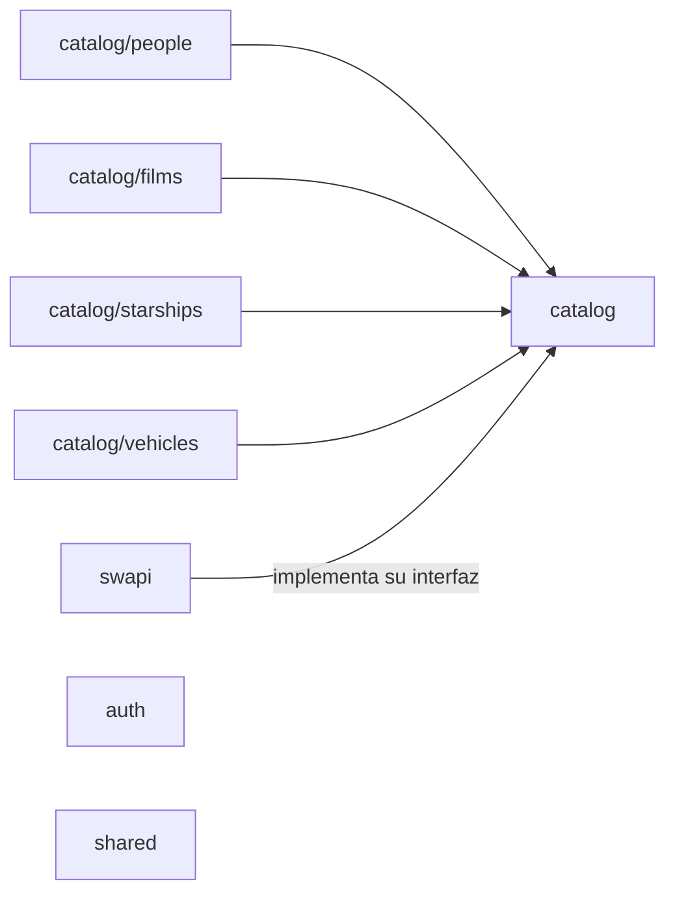
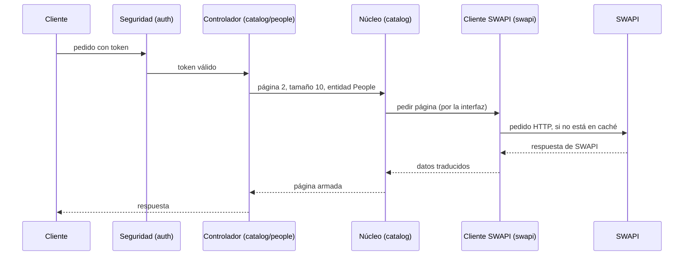

# Arquitectura

Cómo se organiza el código y qué reglas sigue. Es la referencia para el día a día: dónde va cada cosa y qué puede depender de qué. El porqué de cada decisión está en los [ADRs](adr/README.md).

> **Estado:** define la estructura objetivo del MVP. El código se escribe siguiendo este documento; si la estructura cambia, primero se registra un ADR y después se actualiza acá.

## En una frase

Una API en Spring Boot que lee los datos de Star Wars desde SWAPI, los pagina y los filtra de forma uniforme, y los protege con login. No guarda datos de Star Wars: su base de datos contiene solo usuarios.

## Carpetas

El código se organiza por funcionalidad ([ADR-0002](adr/0002-code-organization.md)).

```
src/main/java/io/github/erickvaernet/starwars
├── auth/          login, emisión del token y usuarios
├── catalog/       núcleo común: páginas, filtros y la interfaz hacia la fuente de datos
│   ├── people/    controlador y datos propios de People
│   ├── films/
│   ├── starships/
│   └── vehicles/
├── swapi/         cliente de SWAPI, traducción de sus respuestas y caché
└── shared/        errores, configuración y documentación de la API

src/main/resources/db
├── migration/     tablas e índices
└── seed/          usuarios de prueba

src/test/java/...  misma estructura de carpetas que el código que prueba
```

| Carpeta     | Qué contiene                                                                                   | Qué no contiene                                    |
|-------------|------------------------------------------------------------------------------------------------|----------------------------------------------------|
| `auth`      | El pedido de login, la emisión del token, la tabla de usuarios y las reglas de acceso          | Nada sobre Star Wars                               |
| `catalog`   | El modelo de página, los filtros, la lógica de paginación y la interfaz de la fuente de datos  | Nada con el formato de SWAPI                       |
| `catalog/*` | Por entidad: su controlador, su documentación y sus datos de detalle                           | Lógica de paginación o de filtros                  |
| `swapi`     | Los pedidos HTTP a SWAPI, la traducción de sus respuestas y la caché                           | Controladores o reglas de la API propia            |
| `shared`    | El formato de los errores, la configuración general y la de la documentación de la API         | Lógica de una funcionalidad en particular          |

## Reglas de dependencia



1. **`catalog` no conoce a `swapi`.** `catalog` define la interfaz de la fuente de datos y `swapi` la implementa.
2. **El formato de SWAPI no sale de `swapi`.** Sus respuestas se traducen ahí al modelo de `catalog`.
3. **`auth` y `catalog` no dependen entre sí.**
4. **Nada depende de un controlador.**
5. **Cualquier carpeta puede usar `shared`;** `shared` no usa a ninguna otra.

Estas reglas se comprueban con tests de arquitectura ([ADR-0009](adr/0009-testing-strategy.md)). Si una se rompe, los tests fallan.

## Recorrido de un pedido

Ejemplo: `GET /api/v1/people?page=2&size=10`.



1. La seguridad valida el token. Sin token válido, responde 401 y el pedido no sigue ([ADR-0005](adr/0005-authentication.md)).
2. El controlador de la entidad valida los parámetros y llama al núcleo.
3. El núcleo pide los datos por la interfaz, sin saber que detrás está SWAPI.
4. El cliente de SWAPI responde desde la caché o hace el pedido HTTP ([ADR-0003](adr/0003-swapi-client.md), [ADR-0011](adr/0011-swapi-response-cache.md)).
5. El núcleo arma la página: usa la de SWAPI si vino paginada, o recorta en memoria si vino la lista completa ([ADR-0004](adr/0004-pagination-and-filters.md)).

## Cómo se agrega una entidad

Sumar una entidad de SWAPI (por ejemplo, Planets) no toca la paginación ni los filtros:

1. Crear su carpeta dentro de `catalog`.
2. Definir sus datos de detalle.
3. Declarar su ruta, su nombre en SWAPI y el campo por el que se busca.
4. Agregar sus tests de aceptación.

## Decisiones transversales

| Tema                       | Regla                                                                                   | ADR                                            |
|----------------------------|-----------------------------------------------------------------------------------------|------------------------------------------------|
| Plataforma                 | Spring Boot 4.1 sobre Java 21, compilado con nivel de lenguaje 21                       | [ADR-0001](adr/0001-platform-and-build.md)     |
| Rutas                      | Todas bajo `/api/v1`                                                                    | [ADR-0004](adr/0004-pagination-and-filters.md) |
| Paginación                 | Páginas desde 1; tamaño por defecto 10 y máximo 100                                     | [ADR-0004](adr/0004-pagination-and-filters.md) |
| Seguridad                  | Todo cerrado por defecto; solo son públicos el login, la documentación y el control de estado | [ADR-0005](adr/0005-authentication.md)   |
| Base de datos              | Solo usuarios. El esquema cambia únicamente con archivos de Flyway                      | [ADR-0006](adr/0006-users-database-and-seed.md) |
| Errores                    | Siempre en formato Problem Details, sin detalles internos                               | [ADR-0007](adr/0007-error-format.md)           |
| Documentación de la API    | Se genera desde el código; cada pedido documenta parámetros, respuestas y errores       | [ADR-0008](adr/0008-api-documentation.md)      |
| Configuración              | Lo sensible viene de variables de entorno; ningún secreto en el repositorio             | [ADR-0010](adr/0010-local-environment.md)      |
| Tests                      | Nunca llaman a la SWAPI real                                                            | [ADR-0009](adr/0009-testing-strategy.md)       |

## Documentación del código

- Javadoc en las clases e interfaces públicas y en los métodos cuyo comportamiento no es obvio.
- El comentario explica el **porqué** o el comportamiento que no se ve a simple vista. No repite lo que el código ya dice.
- Los nombres de clases, métodos y variables van en inglés.
