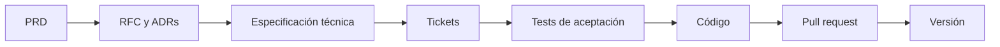

# Flujo de trabajo

Cómo se trabaja en este proyecto, de la consigna al código entregado. Las reglas puntuales (formato de commits, ramas, tickets y pull requests) están en [`CONVENTIONS.md`](../CONVENTIONS.md); este documento explica el recorrido completo y por qué es así.

## Qué es

Es un flujo de **desarrollo guiado por especificaciones**: primero se escribe qué se quiere construir, después cómo, y recién entonces se programa. La especificación es la fuente de verdad y el código se deriva de ella.

Combina dos orígenes:

- **Prácticas de proyectos anteriores del autor:** PRD, RFC, ADRs, priorización y ciclos cortos.
- **Ideas de Spec Kit y OpenSpec**, dos herramientas de desarrollo guiado por especificaciones. No se adoptó ninguna de las dos; el motivo está [al final](#relación-con-spec-kit-y-openspec).

## Principios

1. **El qué y el cómo van en documentos distintos.** El PRD no nombra tecnologías, salvo las que impone la consigna.
2. **No se avanza con dudas.** Las preguntas abiertas se responden una por una antes de aprobar un documento.
3. **Cada etapa tiene una aprobación humana.** Ninguna empieza hasta que la anterior está revisada y aprobada.
4. **Cada decisión técnica queda registrada** en un ADR, con las alternativas descartadas. Un ADR aceptado no se modifica: se reemplaza por otro. Solo admite notas fechadas que no cambian la decisión.
5. **Los tests se escriben antes que el código,** a partir de criterios de aceptación ya aprobados.
6. **Se trabaja en ciclos cortos** y cada ciclo termina con una versión que se puede entregar.
7. **Todo se puede rastrear:** del requisito a la decisión, de la decisión a la regla, de la regla al ticket y del ticket al test.

## El recorrido

| # | Etapa                      | Qué se hace                                                                                         | Qué produce                                             | Se aprueba cuando                                              |
|---|----------------------------|-----------------------------------------------------------------------------------------------------|---------------------------------------------------------|----------------------------------------------------------------|
| 1 | **PRD**                    | Se define qué se construye y por qué: problema, usuarios, requisitos como historias de usuario, prioridades y ciclos | [`requirements/PRD.md`](../requirements/PRD.md) | No quedan preguntas abiertas y el autor lo aprueba            |
| 2 | **RFC y ADRs**             | Se decide cómo construirlo: arquitectura, tecnologías y seguridad, comparando alternativas           | Un RFC en `rfc/` y un ADR por decisión en `adr/`        | Cada decisión tiene su ADR aceptado                            |
| 3 | **Especificación técnica** | Se baja todo a detalle ejecutable: contrato de la API, validaciones, casos límite y criterios de aceptación | `spec/SPEC.md`                                   | Cada requisito del ciclo tiene criterios verificables          |
| 4 | **Tickets**                | Cada historia de usuario pasa a ser un ticket, con sus tareas técnicas adentro y sus dependencias    | Issues de GitHub, agrupados en el hito del ciclo        | Todos los requisitos del ciclo tienen ticket                   |
| 5 | **Tests de aceptación**    | Se escriben a partir de los criterios, antes que el código. Al principio fallan                      | Tests en la rama del ticket                             | Se revisó que prueban lo que pide la historia                  |
| 6 | **Código**                 | Se implementa tarea por tarea, con un test unitario antes de cada parte, hasta que todo pasa         | Código y tests unitarios                                | Se cumple la definición de terminado                           |
| 7 | **Pull request**           | Se revisa el cambio completo y se fusiona en la rama principal                                       | Un commit en `main` y el ticket cerrado                 | Una persona revisó el código                                   |
| 8 | **Versión**                | Al cerrar el ciclo se etiqueta la versión                                                           | `v0.1.0`, `v0.2.0`, `v0.3.0`                            | Todos los tests pasan y el hito no tiene tickets abiertos      |

Las etapas 1 a 4 se hacen una vez por ciclo. Las etapas 5 a 7 se repiten por cada ticket.

## Las cuatro fases del desarrollo guiado por especificaciones

Spec Kit ordena el trabajo en cuatro fases. Este flujo las cubre así:

| Fase            | Qué significa                                    | En este flujo                                    |
|-----------------|--------------------------------------------------|--------------------------------------------------|
| **Especificar** | Definir qué se quiere y por qué                  | PRD                                              |
| **Planificar**  | Traducir la intención en un diseño técnico       | RFC y ADRs (decisiones) y especificación técnica (detalle) |
| **Tareas**      | Descomponer el plan en unidades de trabajo       | Tickets: una historia de usuario con sus tareas  |
| **Implementar** | Generar el código y validarlo                    | Tests de aceptación, código, pull request        |

Una aclaración de nombres: en Spec Kit, "spec" es el documento del qué, que acá es el PRD. Lo que este proyecto llama **especificación técnica** pertenece a la fase de planificar.

## Ciclos

El trabajo se reparte en tres ciclos según la prioridad de cada requisito. El detalle está en los [hitos del PRD](../requirements/PRD.md#hitos).

| Ciclo      | Requisitos | Versión  |
|------------|------------|----------|
| 1. MVP     | "Debe"     | `v0.1.0` |
| 2. Mejoras | "Debería"  | `v0.2.0` |
| 3. Extras  | "Podría"   | `v0.3.0` |

- En el ciclo 1, el PRD, el RFC y la especificación técnica se escriben completos.
- En los ciclos siguientes no se rehacen: se revisan las prioridades del PRD, se registra un ADR por cada decisión nueva y se extiende la especificación técnica con lo que entra.

## Historias de usuario y tareas

Son dos niveles distintos y el flujo usa los dos:

|                 | Historia de usuario                          | Tarea                                   |
|-----------------|----------------------------------------------|-----------------------------------------|
| Punto de vista  | El usuario: qué valor recibe                 | Quien programa: qué hay que hacer       |
| Dónde nace      | En el PRD, una por requisito                 | En el ticket, al desglosar la historia  |
| Se verifica con | Tests de aceptación                          | Tests unitarios                         |

- **El ticket es la historia.** Las tareas son su lista de pasos.
- **El trabajo de base se hace dentro de la primera historia que lo necesita.** Solo lleva ticket propio lo que no pertenece a ninguna, como el esqueleto del proyecto.
- **Las pruebas y el código documentado no son tickets:** forman parte de la definición de terminado de cada uno.

## Verificación

Cada ticket se verifica en dos niveles de tests y una revisión:

1. **Tests de aceptación de la historia.** Fallan hasta que la historia está completa.
2. **Tests unitarios de cada tarea**, escritos antes de su código.
3. **Revisión humana** del pull request.

Que los tests pasen es necesario, pero no alcanza. Estos son sus límites y cómo se cubren:

| Límite                                              | Riesgo                                                                 | Cómo se cubre                                                                 |
|-----------------------------------------------------|------------------------------------------------------------------------|-------------------------------------------------------------------------------|
| Quien escribe el código también escribe los tests   | Si entendió mal la historia, el test repite el error y pasa igual      | Los tests salen de criterios ya aprobados y se revisan antes del código       |
| Se modifica el test para que pase                   | El test deja de probar lo que debía                                    | Los tests revisados quedan fijos; cambiarlos exige corregir el criterio       |
| Un test solo prueba lo que cubre                    | El código pasa todo y falla en lo que nadie probó                      | Los criterios de aceptación incluyen casos límite, no solo el caso esperado   |
| Hay cualidades que un test no mide                  | Código poco claro, mal diseñado o inseguro                             | Revisión humana del pull request                                              |
| Los tests no llaman a SWAPI                         | Se verifica lo que se cree que SWAPI responde, no lo que responde      | Se usan respuestas reales grabadas, no inventadas                             |

## Uso de herramientas de IA

El equipo técnico de Conexa permitió usar herramientas de IA y pidió documentar el flujo. En cada etapa, la herramienta propone y una persona decide:

| Etapa                  | Qué hace la herramienta de IA                                   | Qué decide una persona                                  |
|------------------------|-----------------------------------------------------------------|---------------------------------------------------------|
| PRD                    | Redacta, detecta dudas y las plantea una por una                | Responde cada pregunta, fija prioridades y aprueba      |
| RFC y ADRs             | Releva alternativas con sus ventajas y desventajas              | Elige y acepta cada decisión                            |
| Especificación técnica | Redacta el contrato y los criterios de aceptación               | Revisa que reflejen los requisitos                      |
| Tests de aceptación    | Los escribe a partir de los criterios                           | Revisa que prueben lo que pide la historia              |
| Código                 | Implementa hasta que los tests pasan, ejecutándolos ella misma  | Revisa el pull request y decide si se fusiona           |

Dos reglas para esta parte:

- **Los tests son la forma en que la herramienta verifica su propio trabajo:** los ejecuta, lee las fallas y corrige. Por eso se escriben y se revisan antes que el código.
- **El trabajo de base se hace en secuencia.** Recién cuando hay una primera historia completa y revisada, que sirve de ejemplo, las historias parecidas pueden implementarse en paralelo.

El registro de lo que efectivamente se delegó, cómo se revisó y qué se corrigió a mano se lleva en `process/AI-USAGE.md` durante la implementación (REQ-18).

## Dónde vive cada regla

| Tipo de regla                                                        | Dónde está                                         | Cuándo cambia                                   |
|----------------------------------------------------------------------|----------------------------------------------------|-------------------------------------------------|
| Qué se construye y con qué prioridad                                 | [`requirements/PRD.md`](../requirements/PRD.md)    | Al empezar cada ciclo                           |
| Por qué se eligió cada tecnología o diseño | [`adr/`](../adr/README.md), un archivo por decisión | Nunca: una decisión nueva reemplaza a la anterior |
| Cómo se organiza el código: carpetas, capas y dependencias permitidas | [`ARCHITECTURE.md`](../ARCHITECTURE.md) | Cuando un ADR nuevo cambia la arquitectura |
| Qué debe hacer exactamente la aplicación                             | `spec/SPEC.md`                                     | Crece con cada ciclo                            |
| Cómo se trabaja: commits, ramas, tickets y pull requests             | [`CONVENTIONS.md`](../CONVENTIONS.md)              | Cuando cambia la forma de trabajo               |
| El recorrido completo y su porqué                                    | Este documento                                     | Cuando cambia el flujo                          |
| Qué debe leer y respetar una herramienta de IA | [`AGENTS.md`](../../AGENTS.md), que solo enlaza a los documentos anteriores | Cuando se agrega o se mueve un documento |

Cada regla está en un solo lugar y los demás documentos la enlazan. Siempre que se pueda, una regla se verifica de forma automática (con el compilador, un test o una herramienta de análisis) en vez de depender de que alguien la recuerde.

## Relación con Spec Kit y OpenSpec

Qué se tomó de cada lado:

| Origen                 | Qué aporta al flujo                                                                         |
|------------------------|---------------------------------------------------------------------------------------------|
| Proyectos anteriores   | PRD, RFC y ADRs como documentos separados; priorización "Debe / Debería / Podría"; ciclos cortos |
| Spec Kit               | Las cuatro fases; la especificación como fuente de verdad; las tareas agrupadas por historia de usuario |
| OpenSpec               | Cada ciclo se trata como un cambio que extiende la especificación existente, sin reescribirla |

Por qué no se adoptó ninguna de las dos herramientas:

- **El flujo ya cubre las mismas fases,** con los documentos que el equipo técnico pidió (ADRs y flujo de trabajo documentado). Sumar una herramienta duplicaría documentos: sus plantillas de especificación y de plan se superponen con el PRD y el RFC.
- **El plazo es corto.** Instalarla y adaptar sus plantillas consume tiempo que rinde más en el producto.
- **Las reglas quedan a la vista.** Un flujo propio, corto y escrito en el repositorio se puede leer y discutir sin conocer ninguna herramienta.
